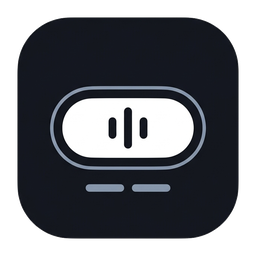
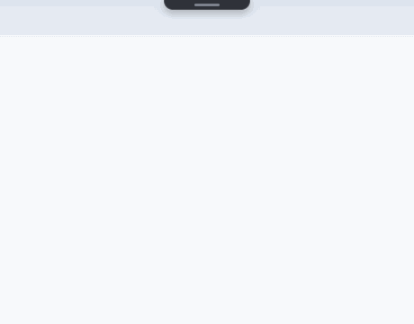

<div align="center">
  
  <h1>Agent Island</h1>
  <p>A lightweight Windows Dynamic Island monitor for <strong>Codex</strong> and <strong>Antigravity</strong> conversations.</p>
  <p>
    <a href="README.md">中文</a> | <strong>English</strong>
  </p>
  <p>
    
  </p>
</div>

---

## Features

- **Top-Center Dynamic Island Pill**: Always-on-top translucent floating capsule at the top of your screen. Automatically shrinks into a minimal top-edge indicator bar when idle and expands on hover.
- **Dual-Agent Live Monitoring**:
  - **Codex**: Read-only monitoring of `%USERPROFILE%\.codex\state_5.sqlite`, `thread_history_1.sqlite`, and `thread-writer-locks/*.lock`.
  - **Antigravity**: Connects to the live `ConversationService` hub via `%USERPROFILE%\.gemini\antigravity\daemon\hub_*.json`, with automatic fallback to `conversation_summaries.db` and `presence/*.lock`.
- **Smart Startup Filtering**: On launch, tracks only currently **running** conversations and newly triggered tasks afterwards — no clutter from old idle history.
- **Island Completion Toast**: Pops an animated Island toast for 5 seconds whenever a running task finishes, fails, or is interrupted; empty expanded panels auto-collapse after 2 seconds.
- **One-Click Jump & Auto-Dismiss**: Click any conversation item or toast to open it via `codex://` or `antigravity://` and automatically clear its "Waiting for reply" state. Includes a per-item `✕` dismiss button.
- **Bilingual UI (`中文` / `English`)**: Switch languages anytime from the panel header button or the system tray menu (persisted across restarts).
- **Background Tray & Visibility Guard**: Runs quietly in the system tray and automatically recovers visibility and topmost z-order after `Win+D` or display changes.

---

## Quick Start

### Requirements

- Windows 10 / 11
- Node.js `>= 22.16` (uses built-in `node:sqlite`, zero native C++ build dependencies)

### Install & Run

```powershell
git clone https://github.com/lvchao23333-commits/agent-island.git
cd agent-island
npm install
npm start
```

### Run Tests

```powershell
npm test
```

---

## Controls & Behavior

| State / Action | Behavior |
| --- | --- |
| **No active chats** | Shrinks into a minimal top-edge bar; hover to reveal the status pill |
| **Click pill** | Expands the panel grouped into **Running** and **Waiting for reply** |
| **Click item / toast** | Opens the target app/conversation and clears its waiting state |
| **Click `✕` on an item** | Hides it from the Island list (never deletes source data; reappears if run again) |
| **Empty panel** | Auto-collapses back to the top bar after 2 seconds |
| **System tray icon** | Left-click to bring Island to front; right-click for Show/Hide, Language, Notifications, Refresh, Quit |

---

## Project Structure

```text
island/
├── assets/
│   ├── demo.gif                  # Runtime preview animation
│   ├── icon.png / icon.ico       # App & window icons
│   └── tray.png                  # System tray icon
├── src/
│   ├── main.js                   # Electron main process, tray, settings persistence & poller
│   ├── preload.js                # Safe IPC bridge
│   ├── stateTracker.js           # State diff engine (running -> finished detection & dismiss)
│   ├── monitors/
│   │   ├── codexMonitor.js       # Codex read-only SQLite & lock monitor
│   │   └── antigravityMonitor.js # Antigravity Hub API & SQLite fallback monitor
│   └── renderer/
│       ├── index.html            # Dynamic Island layout
│       ├── styles.css            # Pill / toast / panel styles & transitions
│       └── app.js                # UI rendering, i18n, auto-collapse & loading feedback
└── test/
    └── stateTracker.test.js      # Unit tests for state tracker & monitors
```

## License

[MIT](LICENSE)
