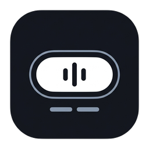
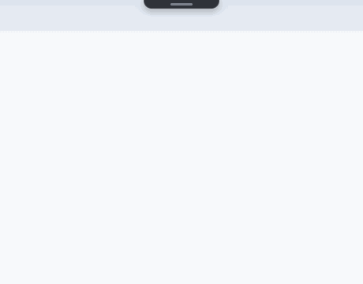

<div align="center">
  
  <h1>Agent Island</h1>
  <p>轻量级 Windows 桌面灵动岛监控工具，实时追踪 <strong>Codex</strong> 与 <strong>Antigravity（反重力）</strong> 对话状态。</p>
  <p>
    
  </p>
</div>

---

## 核心特性

- **顶部灵动岛悬浮胶囊**：常驻屏幕顶部居中、置顶透明圆角设计；空闲时自动贴边缩成极简指示条，鼠标移入即刻展开。
- **双引擎实时监控**：
  - **Codex**：只读读取本地 `%USERPROFILE%\.codex\state_5.sqlite`、`thread_history_1.sqlite` 及 `thread-writer-locks/*.lock`。
  - **Antigravity**：优先连接 `%USERPROFILE%\.gemini\antigravity\daemon\hub_*.json` 暴露的 `ConversationService` 实时状态，离线时自动回退至 `conversation_summaries.db` 与 `presence/*.lock`。
- **智能启动过滤**：启动时仅关注当前**正在运行中**的对话及后续新触发的任务，不被历史旧会话刷屏。
- **灵动岛完成提醒**：当运行中的对话完成、中断或失败时，灵动岛自动弹出提醒条（5 秒后自动收起）；无活跃对话时展开面板会在 2 秒后自动合拢。
- **一键跳转 & 状态清理**：点击列表项或完成提醒直接通过 `codex://` / `antigravity://` 协议唤起对应对话并自动消除「等待回复」状态；支持单条 `✕` 安全移除列表。
- **后台常驻与防消失保护**：系统托盘常驻运行，支持 `Win+D` / 全屏切换后自动恢复可见与置顶。

---

## 快速开始

### 环境要求

- Windows 10 / 11
- Node.js `>= 22.16`（内置 `node:sqlite`，无需额外编译原生 SQLite 依赖）

### 安装与运行

```powershell
git clone https://github.com/lvchao23333-commits/agent-island.git
cd agent-island
npm install
npm start
```

### 运行测试

```powershell
npm test
```

---

## 交互说明

| 状态 / 操作 | 行为说明 |
| --- | --- |
| **无活跃对话** | 自动贴合屏幕顶部缩成小指示条，鼠标悬停展开胶囊 |
| **点击胶囊** | 展开任务面板，按「正在运行」与「等待回复」分组展示 |
| **点击对话项 / 提醒弹窗** | 唤起对应客户端跳转对话，并自动取消该条目的等待回复状态 |
| **点击条目右侧 `✕`** | 将该对话从灵动岛列表隐藏（不删除原始对话；若再次运行会自动恢复） |
| **空面板自动收起** | 展开面板中无任何活跃对话时，展示 2 秒后自动收起 |
| **托盘图标** | 左键唤起/置顶灵动岛；右键可切换显示、开启 Windows 通知、刷新或退出 |

---

## 项目结构

```text
island/
├── assets/
│   ├── demo.gif                  # 运行时效果演示
│   ├── icon.png / icon.ico       # 应用与窗口图标
│   └── tray.png                  # 系统托盘图标
├── src/
│   ├── main.js                   # Electron 主进程、托盘、置顶保活与轮询调度
│   ├── preload.js                # 安全的 IPC 桥接
│   ├── stateTracker.js           # 状态差分引擎（运行 -> 完成事件检测与忽略管理）
│   ├── monitors/
│   │   ├── codexMonitor.js       # Codex 只读 SQLite & 锁文件监控
│   │   └── antigravityMonitor.js # Antigravity Hub API & SQLite 回退监控
│   └── renderer/
│       ├── index.html            # 灵动岛视图结构
│       ├── styles.css            # 胶囊 / 弹窗 / 面板样式与过渡动画
│       └── app.js                # 渲染逻辑、自动收起与加载反馈
└── test/
    └── stateTracker.test.js      # 状态机与监控器单元测试
```
